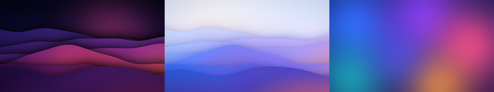

# vPC — un Windows façon macOS

Un kit à double-cliquer pour donner à Windows 10 / 11 un look façon Mac : dock, barre de menus en haut, menu clic droit translucide, curseurs macOS, accent bleu Apple et fonds d'écran 4K.



## Ce que ça change

| Élément | Avant | Après | Outil (gratuit) |
|---|---|---|---|
| Barre des tâches | Barre Windows | **Dock** en bas + **barre de menus** en haut | [Seelen UI](https://github.com/eythaann/Seelen-UI) |
| Clic droit | Menu Windows | Menu translucide et arrondi, survol **bleu Apple** (suit le mode clair/sombre) | [Nilesoft Shell](https://nilesoft.org) |
| Fond d'écran | — | 3 fonds originaux 4K : *Nuit*, *Jour*, *Aurore* | inclus |
| Souris | Curseurs Windows | Curseurs macOS | [apple_cursor](https://github.com/ful1e5/apple_cursor) |
| Couleurs | — | Mode sombre ou clair, accent `#007AFF`, transparence, barres de titre neutres | réglages Windows |
| Barre Espace | — | **Aperçu rapide** d'un fichier, comme sur Mac | [QuickLook](https://github.com/QL-Win/QuickLook) |
| Recherche | Win + S | Recherche façon **Spotlight** | [PowerToys](https://github.com/microsoft/PowerToys) |

Chaque élément est **optionnel** : l'installateur te pose la question pour chacun.

## Installation (5 minutes)

**Il te faut :** Windows 10 (version 1809 ou plus récente) ou Windows 11, et une connexion internet.

1. **Récupère le dossier** : avec GitHub Desktop (*Repository > Show in Explorer*), ou sur GitHub via le bouton vert **Code > Download ZIP**, puis *Extraire tout*.
2. **Double-clique sur `Installer.bat`**.
   - Si Windows affiche « Windows a protégé votre ordinateur » : clique sur **Informations complémentaires**, puis sur **Exécuter quand même**. C'est normal pour un script téléchargé.
3. **Réponds aux questions.** Appuie juste sur **Entrée** pour garder le choix par défaut (entre crochets).
4. **Accepte les fenêtres** « Voulez-vous autoriser cette application… » : elles servent à installer les applications (dock, menu clic droit…).

À la fin, l'écran clignote une seconde (redémarrage de l'Explorateur Windows) et le dock apparaît.

> Pour tout installer sans questions : ouvre un terminal dans le dossier et lance `Installer.bat -Auto` (ajoute `-Mode Clair` pour le mode clair).

## Raccourcis à la Mac

| Action | Raccourci |
|---|---|
| Aperçu rapide d'un fichier | Sélectionne-le dans l'Explorateur, puis **Espace** |
| Recherche façon Spotlight | **Win + Alt + Espace** (modifiable dans PowerToys > Command Palette, par exemple en Alt + Espace) |
| Réglages du dock et de la barre du haut | Clic droit sur le dock ou sur la barre du haut |

## Peaufiner

### Dock et barre de menus (Seelen UI)

Par défaut, Seelen UI est déjà réglé façon Mac : barre en haut, dock en bas qui se cache quand une fenêtre passe dessous, et pas de mosaïque de fenêtres. Dans ses paramètres, tu peux :

- changer la **taille des icônes** du dock et son masquage automatique ;
- essayer d'autres **thèmes** ;
- vérifier que Seelen UI **démarre avec Windows**.

### Menu clic droit

Le thème est dans [`config/nilesoft/theme.nss`](config/nilesoft/theme.nss). Tu peux y changer la couleur de survol (`back.select`), l'arrondi (`radius`, de 0 à 4) ou l'opacité du fond. Relance ensuite `Installer.bat` pour l'appliquer.

### Garder la barre Windows, mais en forme de dock (Windows 11)

Si tu préfères ne pas installer Seelen UI :

1. Installe [Windhawk](https://windhawk.net) : `winget install RamenSoftware.Windhawk`.
2. Dans Windhawk, cherche le mod **Windows 11 Taskbar Styler** et installe-le.
3. Dans ses réglages, choisis le thème **DockLike**, ou **LiquidGlass** pour un effet verre façon macOS récent.

### Autres idées

- **Fonds d'écran animés** : `winget install rocksdanister.LivelyWallpaper`
- **Barre des tâches transparente** (sans dock) : `winget install CharlesMilette.TranslucentTB`
- **Tes propres fonds d'écran** : modifie les couleurs dans `tools/generate_wallpapers.py`, puis lance `python tools/generate_wallpapers.py` (nécessite `numpy` et `Pillow`).

## Tout annuler

Double-clique sur **`Restaurer.bat`**. Il remet comme avant le thème, les couleurs, la barre des tâches, le fond d'écran, les curseurs et le menu clic droit, puis te propose de désinstaller les applications ajoutées par vPC.

Avant toute modification, l'installateur sauvegarde l'état d'origine dans `%LOCALAPPDATA%\vPC\sauvegarde`. Relancer l'installateur n'écrase pas cette sauvegarde.

## Dépannage

| Problème | Solution |
|---|---|
| « winget n'est pas reconnu » | Installe **Programme d'installation d'application** (*App Installer*) depuis le Microsoft Store, puis relance. |
| Le fond d'écran redevient l'ancien | *Paramètres > Personnalisation > Arrière-plan* : choisis **Image** (pas *Diaporama* ni *Windows à la une*), puis relance. |
| Le menu clic droit n'a pas changé | Redémarre le PC. Sinon, dans un terminal **administrateur** : `"C:\Program Files\Nilesoft Shell\shell.exe" -register -restart` |
| Certaines couleurs ne sont pas à jour | Déconnecte-toi puis reconnecte-toi à ta session Windows. |
| Le bouton Widgets est toujours là | Windows le verrouille parfois : clic droit sur la barre des tâches > *Paramètres de la barre des tâches* > désactive **Widgets**. |
| Le dock n'apparaît pas | Lance **Seelen UI** depuis le menu Démarrer. |

## Ce que le script modifie

Rien n'est caché. Toutes les modifications concernent **ton compte uniquement** (`HKEY_CURRENT_USER`), sauf l'installation des applications et le fichier de thème de Nilesoft Shell.

- **Thème** : `…\Themes\Personalize` (mode clair/sombre, transparence), `…\Explorer\Accent` et `…\DWM` (couleur d'accent), `Control Panel\Desktop\AutoColorization`
- **Barre des tâches** : `…\Search\SearchboxTaskbarMode`, `…\Explorer\Advanced` (`ShowTaskViewButton`, `ShowCopilotButton`, `TaskbarAl`, `TaskbarMn`, `TaskbarDa`), `…\Feeds` (Windows 10)
- **Fond d'écran** : copié dans `%LOCALAPPDATA%\vPC\fonds`, appliqué en mode *Remplir*
- **Curseurs** : copiés dans `%LOCALAPPDATA%\vPC\curseurs`, appliqués via `Control Panel\Cursors`
- **Menu clic droit** : remplace `C:\Program Files\Nilesoft Shell\imports\theme.nss` (l'original est sauvegardé)
- **Applications** (via `winget`) : `Nilesoft.Shell`, `Seelen.SeelenUI`, `QL-Win.QuickLook`, `Microsoft.PowerToys`

## Contenu du dépôt

```
Installer.bat               ← double-clic pour installer
Restaurer.bat               ← double-clic pour tout annuler
scripts/
  install.ps1               installateur (questions + application)
  restore.ps1               restauration depuis la sauvegarde
  common.ps1                fonctions partagées
config/nilesoft/theme.nss   thème macOS du menu clic droit
wallpapers/                 fonds d'écran 4K (+ apercu.jpg)
tools/generate_wallpapers.py  générateur des fonds d'écran
```

## Crédits

- [Seelen UI](https://github.com/eythaann/Seelen-UI), [Nilesoft Shell](https://github.com/moudey/Shell), [apple_cursor](https://github.com/ful1e5/apple_cursor) (GPL-3.0, téléchargé à l'installation), [QuickLook](https://github.com/QL-Win/QuickLook), [PowerToys](https://github.com/microsoft/PowerToys). Merci à leurs auteurs !
- Les fonds d'écran sont des créations originales générées par `tools/generate_wallpapers.py`.
- vPC n'est pas affilié à Apple. macOS est une marque d'Apple Inc.
